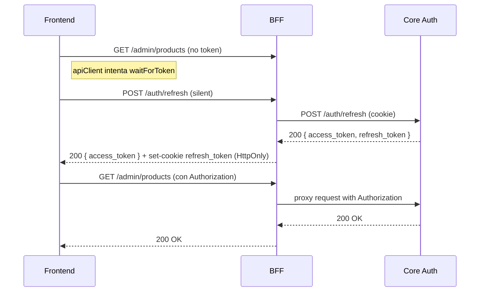

## T002 — Refresh token flow: spec y plan de implementación

Objetivo
- Implementar un flujo de refresh-token seguro y robusto que cubra frontend ↔ BFF ↔ core, elimine carreras en el cliente y permita rotación segura de refresh tokens.

Resumen ejecutivo
- Añadir un endpoint `/auth/refresh` en BFF (proxy) y core (autoridad de sesión). El BFF mantendrá y/o seteará la cookie HttpOnly `refresh_token` y devolverá al frontend el nuevo `access_token` (JSON). El frontend intentará un `silent refresh` antes de cualquier petición admin si no hay token.

Puntos de alineamiento con las políticas del proyecto
- PR/MR gating: según `/.agents/agents.md` y `odd/tasks/*` — no preparar PR/MR hasta que la validación front<->bff<->core y la evidencia QA estén registradas en este archivo y las checklists completadas.
- Filosofía Ponytail: seguir `/.agents/ponytail.md` — soluciones simples, KISS, documentar cualquier atajo con `# ponytail: [razón]`.

Diagrama de secuencia (mermaid)

Tareas (implementación paso a paso)

1) Especificación OpenAPI (BFF)
- Qué: Añadir `POST /auth/refresh` al `bgg-shop-bff/specs/openapi.yaml` con esquemas de request/response y errores (401/400).
- Agente/skill: `OpenAPI Contract Planner` (agent) — usa el skill `specification`/`openapi` del repo.
- Entregables: `openapi.yaml` modificado, PR draft (bloqueado hasta evidencia).
- Criterios de aceptación: OpenAPI valida (`openapi-cli`), tipos regenerados con `npm run generate:types`.

2) Core: endpoint de rotación de refresh token
- Qué: `POST /auth/refresh` en core que valide refresh token, aplique rotación (invalida el anterior), emita nuevo `access_token` y `refresh_token` (hash en DB).
- Agente/skill: `Python Entity Implementer` y `Test Generator (Core)` para pruebas unitarias.
- Entregables: endpoint implementado, tests unitarios que cubran: válido, expirado, reutilizado (replay).
- Criterios de aceptación: tests unitarios pasan en CI.

3) BFF: proxy seguro y manejo de cookie
- Qué: Implementar en BFF `POST /auth/refresh` que llame al core, setee cookie `refresh_token` (HttpOnly, Secure, SameSite=Strict) o la borre en 401.
- Agente/skill: `QA Integration Validator` (to design integration tests) y `Test Generator (BFF)` (implementación de pruebas).
- Entregables: endpoint BFF, integración BFF<->core tests, e2e smoke verifying cookie lifecycle.
- Criterios de aceptación: integración BFF↔CORE pasa; cookie presente, `access_token` JSON devuelto.

4) Frontend: silent refresh y `apiClient` integration
- Qué: Implementar `silentRefresh()` en frontend que llame `POST /auth/refresh` (sin credenciales en cliente), escriba `sessionStorage`, y dispare `bgg-shop:session-change`. Integrar en `apiClient` antes de las peticiones admin: si no hay token, intentar `silentRefresh()`; si falla, disparar `bgg:request-token` (interactive fallback).
- Agente/skill: `React Developer` (agent) para implementar y `speckit.git.feature` (agent) para crear feature branch.
- Entregables: `src/lib/auth.ts` (`silentRefresh`), `apiClient` actualizado, componentes admin actualizados para usar `apiClient` y esperar token.
- Criterios de aceptación: manual test y E2E muestran que la petición admin se hace con Authorization tras refresh.

5) Tests: unitarios, integración y E2E
- Qué: Tests core (pytest), BFF integration (pytest/requests), Frontend E2E (Playwright) que simulan token expirado y validen refresh.
- Agente/skill: `Test Generator (Core)`, `Test Generator (BFF)`, `Test Generator` (general) y `speckit.implement` para ejecutar suites.
- Entregables: tests añadidos bajo `tests/` en cada repo; CI job configurado para ejecutar las rutas nuevas.
- Criterios de aceptación: suites relacionadas pasan en CI y E2E reproduce antes/after metrics.

6) Observabilidad y logging
- Qué: extender `bff-debug-headers.log` para registrar refresh attempts (correlationId, outcome), métricas en Prometheus o logs, y alertas de tasa de 401.
- Agente/skill: `CI/CD and DevOps Agent` y `AzqrCostOptimizeAgent` (para despliegues/monitoring guidance), `mcp_azure_mcp_ser_insights` not directly but use DevOps agent.
- Entregables: logs con refresh events, dashboard básico, alert rule draft.
- Criterios de aceptación: logs muestran refresh events correlacionables, alert threshold definido.

7) Rollout y runbook
- Qué: feature-flag, canary rollout, monitor 401/refresh-failure; runbook para on-call.
- Agente/skill: `CI/CD and DevOps Agent` (deployment plan), `Documentation Agent` (runbook editor).
- Entregables: rollout plan, monitoring checklist, runbook markdown.

Checklist de evidencia (obligatorio antes de abrir PR/MR)
- OpenAPI modificado y `npm run generate:types` ejecutado. (path: `bgg-shop-bff/specs/openapi.yaml`)
- Core unit tests que cubran rotación y replay protection. (path: `bgg-shop-core/tests/...`)
- BFF integration tests que validen cookie lifecycle. (path: `bgg-shop-bff/tests/...`)
- Frontend E2E: Playwright scenario that reproduces expired-token → silent-refresh → success. (path: `bgg-shop-frontend/tests/e2e/...`)
- Observability: logs/metrics proof in `odd/tasks/T002-refresh-token-flow.md` attachments (links to stored logs) or test runs.

Política PR/MR y notas Ponytail
- Según `/.agents/agents.md` y `/.agents/ponytail.md`:
  - No empujar a `main` ni abrir PR/MR hasta que todo lo anterior esté adjuntado en este archivo y marcado en la checklist.
  - Evitar abstracciones innecesarias; cualquier simplificación debe llevar `# ponytail: [razón]` en el código y documentación.

Asignación de agentes y skills por tarea (resumen)
- OpenAPI spec: `OpenAPI Contract Planner` (agent)
- Core implementation & tests: `Python Entity Implementer` + `Test Generator (Core)`
- BFF proxy & integration: `Test Generator (BFF)` + `QA Integration Validator`
- Frontend implementation & E2E: `React Developer` + `Test Generator` (E2E)
- Observability & rollout: `CI/CD and DevOps Agent` + `Documentation Agent`

Ejecución propuesta (orden práctico)
1. `OpenAPI Contract Planner` genera el spec PR draft.
2. Core developer (agent) implementa endpoint y tests.
3. BFF implements proxy and integration tests.
4. Frontend implements `silentRefresh()` and `apiClient` integrations.
5. Add E2E tests and run full validation in a local integration environment.
6. Prepare PR(s) with evidence attached to this `odd/tasks/T002-refresh-token-flow.md`.

Notas finales
- Mantener cambios fragmentados y pequeños (Ponytail): cada repositorio recibe su propia PR con pruebas asociadas; un PR maestro (chained) puede agruparlos si el equipo lo prefiere.
- ¿Querés que cree los artefactos iniciales (OpenAPI patch + branch + PR draft) ahora? Indica si doy permiso para crear branches y drafts automáticos o si prefieres revisar primero el OpenAPI patch aquí.

--
Spec generada automáticamente por agente; referencia: `/.agents/agents.md`, `/.agents/ponytail.md`.
